# App Lanche — Design de Arquitetura

Data: 2026-11-16 · Status: aguardando revisão

## 1. Objetivo e escopo

SaaS B2B2C multi-tenant para escolas infantis com dois módulos sobre um núcleo comum:

1. **Lanche**: coleta diária de pedidos de lanche, pagamento por Pix/cartão, romaneio para a cozinha e tela KDS que funciona sem internet.
2. **Documentos**: a escola gera declarações e comunicados em PDF a partir de modelos e os entrega aos responsáveis por link no WhatsApp.

Escala-alvo nos primeiros 12 meses: 2 a 10 escolas, até ~300 alunos cada.

**Fora do escopo**: aceite ou assinatura de documentos, fatura mensal pós-paga, app nativo, relatórios gerenciais além do romaneio, código público de autenticidade de documentos.

## 2. Decisões tomadas

| Tema | Decisão | Motivo |
|---|---|---|
| Banco | PostgreSQL único (Cloud SQL, `southamerica-east1`) | Ledger de carteira, idempotência por constraint, RLS, SQL para conciliação. O romaneio é congelado no corte, então realtime nativo não é necessário. |
| Cobrança | Híbrida: pagamento por checkout; pagamento tardio ou cancelamento vira crédito em carteira | Evita estorno no gateway e resolve o Pix pago após o corte. |
| Fluxo do dinheiro | Gateway com subconta por escola + split da taxa da plataforma | A plataforma não custodia dinheiro de terceiros; o saldo da carteira é obrigação da escola. |
| Backend | Um serviço Fastify em Cloud Run | Um pool de conexões e um cold start. |
| Webhook de pagamento | Gateway → Node direto (não passa pelo n8n) | O caminho do dinheiro não depende da VPS. |
| Frontend | Uma PWA React + Vite com rotas lazy por área | Um service worker, um deploy. |
| Identidade | O responsável (por escola), não o aluno | Um link e um Pix cobrem todos os filhos. |

## 3. Componentes

```
Pais / Cozinha / Secretaria
        │  HTTPS
Firebase Hosting (PWA estática + rewrite /api/** → Cloud Run)
        │
Cloud Run: apps/api (Fastify)
   ├── Cloud SQL PostgreSQL (fonte única da verdade, RLS)
   ├── Cloud Storage (PDFs, bucket privado, prefixo por escola)
   ├── Secret Manager (segredos HMAC, chaves do gateway)
   └── Cloud Scheduler (dispatcher da outbox e fechamento de segurança em `/jobs/v1/**` com `X-Job-Token`; conciliação na F6)
        ▲                         │ eventos (outbox, HMAC)
        │ REST interno (HMAC)     ▼
      n8n (VPS, Docker) ──► API do WhatsApp
Gateway de pagamento ──► POST /webhooks/payments/:provider/:school_id (direto no Cloud Run)
```

- Rotas `/api/**` são acessadas pelo navegador via Hosting.
- Rotas `/internal/v1/**` e `/webhooks/**` são acessadas pela URL do Cloud Run, sem passar pelo Hosting.
- Toda resposta de `/api/**` leva `Cache-Control: private, no-store`.

## 4. Autenticação e multi-tenant

### 4.1 Magic link do responsável

1. O n8n pede o link ao backend (`POST /internal/v1/schools/{school_id}/reminders/prepare` ou `POST /internal/v1/schools/{school_id}/magic-links`). O n8n nunca gera token.
2. O backend gera 32 bytes aleatórios (base64url) e grava em `magic_links` apenas o SHA-256, com `school_id`, `guardian_id`, `scope`, `service_date` e `expires_at`.
3. A URL é `https://<app>/l#<token>`. O token fica no fragmento: não vai para logs de servidor, referrer nem para o crawler de preview do WhatsApp.
4. O PWA lê o fragmento, apaga-o do histórico (`history.replaceState`) e chama `POST /api/v1/auth/exchange`. Nenhuma rota `GET` altera estado.
5. O link vale até o corte do `service_date` (escopo `order`) ou 7 dias (escopo `documents`) e é reutilizável. A validade é calculada pelo banco (`cutoff_at` do dia ou `now() + 7 dias`).

### 4.2 Vínculo ao aparelho e OTP

- O Firebase Hosting só repassa ao Cloud Run o cookie `__session`. Por isso o identificador do aparelho não é cookie: o PWA gera um `device_secret` de 256 bits, guarda em `localStorage` e o envia no corpo do `exchange`. O servidor guarda o hash em `devices`.
- Responsável ainda sem nenhum aparelho registrado: o primeiro aparelho que troca um link é registrado sem OTP.
- Aparelho já registrado para aquele responsável: entra direto.
- Qualquer outro aparelho: resposta 200 com `status: "step_up_required"` e um `otpToken`; o aparelho é registrado depois de o código ser confirmado. Nesse caso o backend emite `auth.otp_requested` e o n8n envia um código de 6 dígitos por WhatsApp.
- OTP: validade de 5 min, 5 tentativas, hash no banco.
- Limite de emissão: no máximo 3 códigos por pessoa a cada 15 min e 10 por 24 h, contados pelo relógio do banco. Cada bloqueio gera um log de aviso só com o id da pessoa. Acima disso o responsável recebe 429 e nenhuma mensagem é enviada; para a equipe a resposta é a mesma de um e-mail desconhecido.
- O token de OTP devolvido ao navegador é cifrado (JWE `dir` + `A256GCM`, chave derivada do segredo de sessão por HKDF), não apenas assinado: seu conteúdo não revela se a conta existe nem a escola. Para e-mail desconhecido ou bloqueado, a equipe recebe um token de mesmo formato e tamanho. Resíduo aceito: um token real responde 429 na sexta tentativa errada; um inerte continua respondendo `otp_invalid`.
- O desafio pertence a uma pessoa: um código só é aceito para o responsável ou membro da equipe para quem foi emitido.
- Aparelho revogado conta como "já teve aparelho": o responsável cujos aparelhos foram todos revogados precisa de OTP no próximo. Um aparelho revogado que passa pelo OTP volta a ficar ativo.
- Limitação conhecida: no iOS o navegador e a PWA instalada têm armazenamentos separados, então o responsável pode receber um OTP em cada contexto na primeira vez.

### 4.3 Sessão

- JWT assinado (HS256, segredo no Secret Manager), validade de 2 h, em cookie `__session` com `HttpOnly; Secure; SameSite=Lax; Path=/`.
- Claims: `sub` (guardian, staff ou device), `school_id`, `kind` (`guardian` | `staff` | `kitchen`), `scope`.
- Escopos do responsável: `order` (pedir, pagar, ver saldo) e `documents` (listar e baixar). Pedido de reembolso de saldo e alteração de cadastro exigem OTP recente (10 min).
- Equipe (`staff_users`): login por e-mail + OTP; sessão de 8 h; papéis `admin`, `secretaria`, `cozinha`. A cada requisição de equipe, `active` e o papel são relidos do banco; desativar ou trocar o papel vale na hora.
- Proteção contra CSRF: rotas com sessão que alteram estado (métodos diferentes de GET/HEAD/OPTIONS) recusam com 403 `origin_rejected` um `Origin` diferente de `APP_BASE_URL`, ou, sem `Origin`, um `Sec-Fetch-Site` diferente de `same-origin`.
- KDS: pareamento por código de uso único gerado na área admin; o tablet recebe token de dispositivo de 30 dias, escopo `kitchen`, renovado a cada sincronização.

### 4.4 Isolamento entre escolas

- `school_id` nunca é lido de corpo, query string ou header do cliente; vem da sessão, do magic link ou, nas rotas internas, do caminho autenticado por HMAC.
- Todo acesso ao banco passa por `withTenant(schoolId, fn)`, que abre transação e executa `SET LOCAL app.school_id = '<id>'`.
- Todas as tabelas com `school_id` têm RLS: `USING (school_id = current_setting('app.school_id')::uuid)`.
- O papel de banco da aplicação não tem `BYPASSRLS` nem é dono das tabelas. Migrações usam outro papel.
- Chaves estrangeiras entre tabelas de tenant são compostas `(school_id, id)`.
- Jobs que percorrem várias escolas iteram escola a escola, cada uma em seu `withTenant`.
- Antes de existir sessão, o tenant ainda é desconhecido. Só quatro funções `SECURITY DEFINER` consultam sem tenant, cada uma devolvendo o mínimo necessário para então abrir o `withTenant`:
  - `resolve_magic_link(token_hash)` → `school_id`, `magic_link_id`;
  - `resolve_pairing_code(code_hash)` → `school_id`, `device_id`;
  - `resolve_staff_email(email)` → `school_id`, `staff_user_id`;
  - `list_due_actions(now)` → escolas e datas com lembrete ou fechamento vencido.
- O webhook de pagamento não precisa de resolução: cada subconta é configurada com a URL `/webhooks/payments/:provider/:school_id` e um token próprio, validado contra o segredo daquela escola.
- Objetos no Cloud Storage ficam em `schools/<school_id>/…`; o download é sempre por URL assinada de 5 min emitida após checar a sessão.

### 4.5 LGPD

- Escola é controladora; a plataforma é operadora (contrato de operação com cada escola).
- Do aluno guardamos primeiro nome, turma e restrição alimentar. Restrição alimentar é dado de saúde de criança: exige consentimento específico do responsável, registrado em `guardian_students.restriction_consent_at`.
- Mensagens de WhatsApp usam apenas primeiros nomes.
- Telefone, token, OTP e `device_secret` nunca aparecem em log. Logs usam `guardian_id`.
- `audit_log` registra geração de documento, download, ajuste de saldo e ações de equipe.
- Retenção: `magic_links` e `otp_challenges` expirados são apagados após 30 dias; dados de aluno inativo são anonimizados 12 meses após a saída, preservando os lançamentos financeiros.

## 5. Pedido, pagamento e carteira

### 5.1 Modelo

- `service_days`: um registro por escola e data, com `cutoff_at` (timestamptz), `freeze_at` (corte + 5 min) e `status` (`open` | `closed`).
- `checkouts`: carrinho de um responsável para uma data. Contém um `order` por aluno. É a unidade de pagamento.
- `orders`: pedido de um aluno em uma data. É a unidade da cozinha.
- `payments`: cobrança no gateway ligada a um checkout (`pix` ou `card_link`).
- `wallets` e `wallet_entries`: saldo do responsável na escola e seu ledger.

Dois filhos na mesma escola: um link, um checkout com dois `orders`, uma cobrança Pix pelo total. Filhos em escolas diferentes são dois responsáveis, dois links e duas cobranças.

### 5.2 Estados

| Entidade | Estados |
|---|---|
| `checkouts` | `pending_payment` → `paid`; `pending_payment` → `expired`; `pending_payment` → `late_credited`; `expired` → `late_credited`; `paid` → `cancelled` |
| `orders` | `pending` → `confirmed` → `delivered`; `pending` → `expired`; `pending` → `expired_late`; `confirmed` → `cancelled` |
| `payments` | `pending` → `paid`; `pending` → `expired`; `expired` → `paid` (pagamento tardio); `paid` → `refunded` |

Toda transição é um `UPDATE … WHERE status = '<estado anterior>'`; zero linhas afetadas significa que outro processo já fez a transição e a operação termina sem efeito.

### 5.3 Fluxo do checkout

1. `POST /api/v1/checkouts` com `Idempotency-Key`. Em uma transação:
   - trava a linha de `service_days` (`FOR SHARE`) e recusa se `status <> 'open'` ou `now() > cutoff_at`;
   - valida que os alunos pertencem ao responsável e os itens ao cardápio do dia;
   - calcula o total com os preços do servidor;
   - aplica o saldo da carteira: lança `wallet_entries` do tipo `checkout_hold` (débito);
   - se o saldo cobre tudo, o checkout nasce `paid` e os pedidos `confirmed`;
   - senão, cria `payments` pendente pelo restante.
2. Fora da transação, cria a cobrança no gateway com split para a subconta da escola e expiração igual a `cutoff_at`. A chamada usa o `payment.id` como chave de idempotência do gateway.
3. O PWA mostra o Pix Copia e Cola e consulta `GET /api/v1/checkouts/:id` a cada 3 s. Não há WebSocket. Se a cobrança ainda não existe (gateway falhou), a consulta usa `POST /api/v1/checkouts/:id/charge`, que tenta criá-la de novo e devolve o mesmo estado.
4. Ordem de travas em toda transação: `service_days` → `checkouts` → `payments` → `wallets`.
5. Checkout não pago até o corte: `expired`, e o `checkout_hold` é revertido por um lançamento `hold_release`.

### 5.4 Idempotência

| Camada | Mecanismo |
|---|---|
| Requisição do cliente | `idempotency_keys` com `UNIQUE (school_id, key)`; a repetição devolve a resposta gravada. |
| Regra de negócio | Índice único parcial em `orders (school_id, student_id, service_date) WHERE status IN ('pending','confirmed','delivered')`. Cobre toque duplo e dois responsáveis pedindo para o mesmo aluno. |
| Webhook | `payment_events` com `UNIQUE (provider, provider_event_id)` e `INSERT … ON CONFLICT DO NOTHING`. Sem linha inserida, responde 200 e encerra. |
| Ledger | `UNIQUE (school_id, source_type, source_id, kind)` em `wallet_entries`. |
| Eventos de entrega do KDS | `delivery_events.event_id` como chave primária. |

### 5.5 Webhook e conciliação

- `POST /webhooks/payments/:provider/:school_id`: valida o token/assinatura do provedor contra o segredo daquela escola, grava o evento bruto, processa na mesma transação e responde 200. Erro de processamento responde 500 para o gateway reenviar.
- O valor e o identificador da cobrança no evento são conferidos com `payments`; divergência gera alerta e não confirma.
- Job de conciliação (Cloud Scheduler, a cada 5 min e imediatamente antes de cada fechamento): consulta no gateway as cobranças `pending` e aplica a mesma função de confirmação do webhook.

### 5.6 Horário de corte

A confirmação de pagamento e o fechamento do dia travam a mesma linha de `service_days`, então nunca se intercalam.

Função única `confirmPayment(payment, paid_at)`, dentro de uma transação:

- trava `service_days` (`FOR SHARE`);
- se `status = 'open'` e `paid_at <= cutoff_at`: `payments → paid`, `checkouts → paid`, `orders → confirmed`, evento `payment.confirmed`;
- caso contrário: `payments → paid`, `checkouts → late_credited` (a partir de `pending_payment` ou de `expired`), `orders → expired_late`, lançamento de crédito `late_payment_credit` pelo valor pago, reversão do `checkout_hold` se ainda não revertido (a unicidade do ledger garante que o `hold_release` ocorre uma vez só), evento `payment.late_credited`.

`paid_at` é o horário de pagamento informado pelo gateway, não o de chegada do webhook.

Fechamento `closeServiceDay(school, date)`:

1. roda a conciliação daquela escola e data;
2. em transação, trava `service_days` (`FOR UPDATE`); se já está `closed`, devolve o romaneio existente;
3. expira checkouts pendentes e libera seus holds;
4. grava o romaneio congelado em `manifests` (JSON, versão 1);
5. marca `closed` e emite `service_day.closed`.

O fechamento é disparado pelo n8n em `freeze_at`. Um Cloud Scheduler chama `POST /jobs/v1/service-days/safety-close` a cada 5 min e fecha qualquer dia que passou 10 min do corte, caso o n8n esteja fora.

Cancelamento pelo responsável: permitido enquanto o dia está `open` e antes de `cutoff_at`. Checkout `paid` → `cancelled`, e o valor do checkout vira crédito na carteira (`cancel_credit`). Checkout `pending_payment` → `expired` (pedidos `expired`, pagamento `expired`, `hold_release`), para o aluno poder receber outro pedido; se esse Pix for pago depois, vira crédito tardio. Estorno em dinheiro só por pedido à secretaria, com OTP, lançado como `refund` e executado no gateway.

### 5.7 Carteira

- Valores em centavos inteiros (`bigint`); nunca ponto flutuante.
- `wallet_entries` é append-only: sem `UPDATE` nem `DELETE` (revogados do papel da aplicação).
- Cada lançamento trava a linha de `wallets` (`FOR UPDATE`), insere a entrada e atualiza `balance_cents`. `CHECK (balance_cents >= 0)`.
- Tipos: `checkout_hold`, `hold_release`, `late_payment_credit`, `cancel_credit`, `refund`, `manual_adjustment`.

### 5.8 Gateway

Interface `PaymentProvider` (`createCharge`, `getCharge`, `refund`, `parseWebhook`). Implementação: Efí (conta por escola e split). Credenciais por escola ficam no Secret Manager, referenciadas por `schools.payment_account_ref`.

Decisão de 2026-11-17: o gateway é a **Efí** (Pix imediato, `PUT /v2/cob/:txid` com o txid derivado do `payment.id`, sem `devedor`; o Asaas foi descartado porque exige CPF do pagador). Cada escola tem conta Efí própria (credenciais e certificado mTLS por escola) e a taxa da plataforma vai por split Pix da Efí para a conta da plataforma. A Efí não assina o webhook: a URL registrada carrega o segredo da escola (`?token=…&ignorar=`) e cada pagamento notificado é confirmado consultando a cobrança na própria Efí antes de chamar `confirmPayment`. O provedor `fake` serve a desenvolvimento e testes (a API recusa subir com ele sem `ENABLE_FAKE_PAYMENTS=true`). `refund` entra com o reembolso em dinheiro. Os campos `*_ref` de `schools` guardam o nome de uma variável de ambiente que o Cloud Run preenche a partir do Secret Manager (`--set-secrets`); incluir escola exige novo deploy. Referência da API: `docs/efi-pix.md`.

### 5.9 Capacidade

- Pico esperado: poucos milhares de requisições em minutos. O limite real é conexão de banco.
- `max instances × pool por instância` menor que `max_connections` do Cloud SQL, com folga para migrações e jobs (referência inicial: 5 instâncias × 5 conexões).
- 1 instância mínima entre 06h00 e 08h30; concorrência 80 por instância.
- Sem cache de CDN para a API: o volume não justifica e toda resposta é privada.

## 6. Contratos Node ↔ n8n

### 6.1 Autenticação

n8n → Node, em toda chamada:

```
Authorization: Bearer <token de serviço>
X-Timestamp: 2026-11-16T21:00:00Z
X-Signature: hex(HMAC-SHA256(secret, MÉTODO + "\n" + caminho-com-query + "\n" + timestamp + "\n" + corpo))
Idempotency-Key: <uuid>            (em todo POST)
```

Timestamp fora de ±5 min é recusado. O método (maiúsculo) e o caminho com query string entram na assinatura para que uma requisição assinada não possa ser reaproveitada em outra rota ou para outra escola; em requisição sem corpo, o corpo é a string vazia. Node → n8n usa os mesmos `X-Timestamp` e `X-Signature` com outro segredo.

Campos de `data` nos eventos e de corpos trocados com o n8n usam `snake_case`.

Erros seguem `{ "error": { "code": "…", "message": "…" } }` com códigos estáveis.

### 6.2 n8n → Node

**`GET /internal/v1/schedule/due`** — chamado a cada 5 min. O n8n não guarda horário de escola.

```json
{ "due": [
  { "action": "send_reminders", "school_id": "0193…", "service_date": "2026-11-17" },
  { "action": "close_service_day", "school_id": "0193…", "service_date": "2026-11-17" }
] }
```

**`POST /internal/v1/schools/{school_id}/reminders/prepare`**

```json
{ "service_date": "2026-11-17", "cursor": null }
```
```json
{ "batch_id": "0193…", "next_cursor": null,
  "recipients": [
    { "guardian_id": "0193…", "phone": "+5511999990000", "first_name": "Ana",
      "students": ["Léo", "Bia"], "link_url": "https://app.example/l#Zk3…",
      "wallet_balance_cents": 1200, "cutoff_at": "2026-11-17T07:30:00-03:00", "cutoff_local_time": "07:30" }
  ] }
```

Páginas de até 200 destinatários. Responsáveis que já têm pedido confirmado para todos os filhos naquela data não entram. Repetir a chamada para o mesmo lote não reenvia quem já consta como `sent` em `message_deliveries`.

**`POST /internal/v1/schools/{school_id}/reminders/{batch_id}/deliveries`**

```json
{ "results": [ { "guardian_id": "0193…", "status": "sent", "wa_message_id": "wamid.X" },
               { "guardian_id": "0194…", "status": "failed", "error": "invalid_number" } ] }
```
Resposta: `204`.

**`POST /internal/v1/service-days/{school_id}/{date}/close`** — sem corpo.

```json
{ "status": "closed", "closed_at": "2026-11-17T07:35:02-03:00", "manifest_version": 1,
  "kitchen_phone": "+5511988880000",
  "totals": { "orders": 142, "by_item": [ { "item": "Misto quente", "qty": 61 } ] },
  "by_class": [
    { "class": "Infantil 3A",
      "orders": [ { "order_id": "0193…", "student": "Léo", "items": ["Misto quente"], "restrictions": "sem lactose" } ] }
  ],
  "late_credits": 3 }
```

Idempotente: a repetição devolve o mesmo romaneio. O n8n formata o resumo e envia ao WhatsApp da cozinha como contingência.

**`GET /internal/v1/service-days/{school_id}/{date}/manifest`** — mesmo corpo do `close`; `409` se o dia ainda está aberto.

**`POST /internal/v1/schools/{school_id}/magic-links`** — reenvio avulso.

```json
{ "guardian_id": "0193…", "scope": "order", "service_date": "2026-11-17" }
```
```json
{ "link_url": "https://app.example/l#Zk3…", "expires_at": "2026-11-17T07:30:00-03:00" }
```

A escola vem sempre do caminho, coberto pela assinatura HMAC; os corpos não aceitam `school_id`.

### 6.3 Node → n8n (outbox)

Eventos são gravados em `outbox_events` na mesma transação da mudança de estado. Um dispatcher (Cloud Scheduler a cada minuto, mais disparo imediato após o commit) faz `POST` no webhook do n8n, com retry exponencial por até 24 h. O n8n deduplica por `id`.

O dispatcher usa a função `list_schools_with_pending_events()` (quinta consulta sem tenant, além das quatro da seção 4.4), reserva eventos com `FOR UPDATE SKIP LOCKED` e arrendamento de 2 min, e envia fora de transação. Retry: `next_attempt_at = now() + min(2^tentativas, 60) min`; depois de 24 h o evento é abandonado (`failed_at`). Após entregar um `auth.otp_requested`, o `data` vira `{}`; um OTP vencido não é enviado e também é apagado. O disparo imediato roda depois do commit (`afterCommit`); o job de 1 min (`POST /jobs/v1/outbox/dispatch`) garante a entrega.

```json
{ "id": "0193…", "type": "payment.late_credited", "school_id": "0193…",
  "occurred_at": "2026-11-17T07:32:10-03:00",
  "data": { "guardian_id": "0193…", "phone": "+5511999990000", "first_name": "Ana",
            "amount_cents": 1800, "wallet_balance_cents": 1800 } }
```

| Tipo | Uso no n8n |
|---|---|
| `payment.confirmed` | Confirmação do pedido ao responsável |
| `payment.late_credited` | Aviso de pagamento após o corte e do crédito |
| `auth.otp_requested` | Envio do código (WhatsApp ou e-mail, conforme `data.channel`) |
| `service_day.closed` | Notificação opcional à secretaria |
| `document.published` | Envio do link do documento, um evento por responsável |

## 7. KDS offline-first

### 7.1 Princípios

- A tela lê e escreve apenas no IndexedDB (via Dexie). A rede é um processo de sincronização em segundo plano.
- O romaneio é imutável depois de fechado; só os eventos de entrega mudam.
- Nenhum evento local é apagado antes da confirmação do servidor.

### 7.2 Armazenamento local

| Store | Conteúdo |
|---|---|
| `manifest` | Romaneio da data, com versão |
| `orderState` | Estado atual de cada pedido (`pending` \| `delivered`), derivado dos eventos |
| `outbox` | Eventos ainda não confirmados |
| `meta` | Cursor de mudanças, `device_id`, horário da última sincronização |

### 7.3 Operação

1. Service worker (vite-plugin-pwa) faz precache do shell; o KDS abre sem rede.
2. Antes do fechamento, o KDS mostra a prévia parcial e o aviso "aguardando fechamento". Após `closed`, baixa o romaneio e grava em `manifest`.
3. Marcar ou desmarcar "entregue" é uma transação IndexedDB que atualiza `orderState` e insere na `outbox`:
   `{ event_id, order_id, type: "delivered" | "undelivered", occurred_at, device_id }`.
4. Sincronização: no evento `online`, a cada 15 s e quando a aba volta ao foco. A Background Sync API não é usada (ausente no Safari/iOS).
   - `POST /api/kds/v1/events` com até 100 eventos; o servidor insere com `ON CONFLICT (event_id) DO NOTHING` e devolve os `event_id` aceitos; o cliente remove só esses.
   - `GET /api/kds/v1/changes?since=<cursor>` traz eventos de outros tablets.
5. Estado de um pedido: o do evento com maior `occurred_at`; empate resolvido por `event_id`.
6. Token de dispositivo expirado com outbox pendente: o servidor aceita os eventos se o dispositivo ainda está ativo em `devices` e renova o token.

### 7.4 Proteções

- `navigator.storage.persist()` no pareamento.
- Selo fixo: "N pendentes · última sincronização HH:MM"; vermelho após 2 min sem sincronizar.
- Logout e "trocar de escola" bloqueados com outbox não vazia.
- Screen Wake Lock enquanto o KDS está aberto.
- Contingência: o resumo do romaneio chega ao WhatsApp da cozinha pelo n8n.

## 8. Módulo de documentos

- **Modelos** (`document_templates`): corpo em Markdown restrito (títulos, parágrafos, listas, negrito, tabela simples), versionado. Variáveis de uma lista fechada: `{{escola.nome}}`, `{{aluno.primeiro_nome}}`, `{{aluno.nome_completo}}`, `{{turma.nome}}`, `{{responsavel.nome}}`, `{{data.hoje}}`, `{{data.ano_letivo}}`. Variável desconhecida impede salvar o modelo.
- **Nome completo**: `students.full_name` é opcional, preenchido só por escolas que usam documentos que o exigem.
- **Geração**: a secretaria escolhe modelo e público (aluno, turma ou escola). O backend cria um `document_batches` e um `documents` por aluno, renderiza o PDF com `pdfmake` (sem Chromium), grava no bucket e registra `sha256`. O PDF é imutável; corrigir é gerar novo lote.
- **Lotes grandes**: geração assíncrona por Cloud Tasks, 1 tarefa por documento; o lote mostra progresso.
- **Entrega**: ao publicar, um evento `document.published` por responsável; o n8n envia link com escopo `documents`.
- **Leitura**: página "Documentos" no PWA; download por URL assinada de 5 min; `document_views` registra a primeira abertura para a escola acompanhar.

## 9. MER

```mermaid
erDiagram
  schools ||--o{ classes : tem
  schools ||--o{ staff_users : emprega
  schools ||--o{ guardians : cadastra
  schools ||--o{ service_days : abre
  schools ||--o{ menu_items : oferece
  schools ||--o{ document_templates : mantem
  classes ||--o{ students : agrupa
  guardians ||--o{ guardian_students : responde
  students ||--o{ guardian_students : vinculado
  guardians ||--o{ devices : usa
  guardians ||--o{ magic_links : recebe
  guardians ||--o{ otp_challenges : valida
  guardians ||--|| wallets : possui
  wallets ||--o{ wallet_entries : lanca
  service_days ||--o{ service_day_items : cardapio
  menu_items ||--o{ service_day_items : ofertado
  service_days ||--o{ checkouts : recebe
  service_days ||--o| manifests : congela
  guardians ||--o{ checkouts : faz
  checkouts ||--|{ orders : contem
  students ||--o{ orders : consome
  orders ||--|{ order_items : detalha
  menu_items ||--o{ order_items : vendido
  checkouts ||--o{ payments : cobrado
  payments ||--o{ payment_events : notificado
  orders ||--o{ delivery_events : entregue
  devices ||--o{ delivery_events : registra
  document_templates ||--o{ document_batches : origina
  document_batches ||--|{ documents : gera
  students ||--o{ documents : referente
  documents ||--o{ document_views : aberto
  guardians ||--o{ document_views : abre
  reminder_batches ||--o{ message_deliveries : envia

  schools { uuid id PK
    text name
    text timezone
    time default_cutoff_time
    text kitchen_phone
    text payment_account_ref
    text payment_webhook_secret_ref
    int platform_fee_bps }
  classes { uuid id PK
    uuid school_id FK
    text name }
  students { uuid id PK
    uuid school_id FK
    uuid class_id FK
    text external_code
    text first_name
    text full_name
    text dietary_restrictions
    bool active }
  guardians { uuid id PK
    uuid school_id FK
    text phone_e164
    text first_name
    text email }
  guardian_students { uuid school_id FK
    uuid guardian_id FK
    uuid student_id FK
    timestamptz restriction_consent_at }
  staff_users { uuid id PK
    uuid school_id FK
    text email
    text role }
  devices { uuid id PK
    uuid school_id FK
    text kind
    uuid guardian_id FK
    text secret_hash
    text pairing_code_hash
    timestamptz pairing_expires_at
    timestamptz revoked_at }
  magic_links { uuid id PK
    uuid school_id FK
    uuid guardian_id FK
    text token_hash
    text scope
    date service_date
    timestamptz expires_at }
  otp_challenges { uuid id PK
    uuid school_id FK
    text subject_kind
    uuid subject_id
    text code_hash
    int attempts
    timestamptz expires_at }
  menu_items { uuid id PK
    uuid school_id FK
    text name
    bigint price_cents
    bool active }
  service_days { uuid id PK
    uuid school_id FK
    date service_date
    timestamptz cutoff_at
    timestamptz freeze_at
    text status
    timestamptz closed_at }
  service_day_items { uuid school_id FK
    uuid service_day_id FK
    uuid menu_item_id FK
    bigint price_cents }
  checkouts { uuid id PK
    uuid school_id FK
    uuid guardian_id FK
    uuid service_day_id FK
    text status
    bigint total_cents
    bigint wallet_applied_cents }
  orders { uuid id PK
    uuid school_id FK
    uuid checkout_id FK
    uuid student_id FK
    date service_date
    text status }
  order_items { uuid id PK
    uuid school_id FK
    uuid order_id FK
    uuid menu_item_id FK
    int qty
    bigint unit_price_cents }
  payments { uuid id PK
    uuid school_id FK
    uuid checkout_id FK
    text provider
    text provider_charge_id
    text method
    bigint amount_cents
    text status
    timestamptz paid_at
    timestamptz expires_at }
  payment_events { uuid id PK
    text provider
    text provider_event_id
    uuid school_id FK
    uuid payment_id FK
    jsonb raw
    timestamptz received_at }
  wallets { uuid id PK
    uuid school_id FK
    uuid guardian_id FK
    bigint balance_cents }
  wallet_entries { uuid id PK
    uuid school_id FK
    uuid wallet_id FK
    text kind
    bigint amount_cents
    text source_type
    uuid source_id
    timestamptz created_at }
  manifests { uuid id PK
    uuid school_id FK
    uuid service_day_id FK
    int version
    jsonb content }
  delivery_events { uuid event_id PK
    uuid school_id FK
    uuid order_id FK
    uuid device_id FK
    text type
    timestamptz occurred_at
    timestamptz received_at }
  outbox_events { uuid id PK
    uuid school_id FK
    text type
    jsonb data
    int attempts
    timestamptz next_attempt_at
    timestamptz delivered_at }
  idempotency_keys { uuid school_id FK
    text key
    text request_hash
    jsonb response
    timestamptz created_at }
  reminder_batches { uuid id PK
    uuid school_id FK
    date service_date }
  message_deliveries { uuid id PK
    uuid school_id FK
    uuid batch_id FK
    uuid guardian_id FK
    text status
    text wa_message_id }
  document_templates { uuid id PK
    uuid school_id FK
    text name
    int version
    text body_md }
  document_batches { uuid id PK
    uuid school_id FK
    uuid template_id FK
    text audience_kind
    uuid audience_id
    uuid created_by FK
    text status }
  documents { uuid id PK
    uuid school_id FK
    uuid batch_id FK
    uuid student_id FK
    text storage_path
    text sha256
    timestamptz published_at }
  document_views { uuid id PK
    uuid school_id FK
    uuid document_id FK
    uuid guardian_id FK
    timestamptz first_viewed_at }
  audit_log { uuid id PK
    uuid school_id FK
    text actor_kind
    uuid actor_id
    text action
    jsonb detail
    timestamptz created_at }
```



Convenções do esquema:

- Chaves primárias UUID v7 geradas pela aplicação.
- Toda tabela exceto `schools` tem `school_id NOT NULL`, RLS e `UNIQUE (school_id, id)` para servir de alvo das FKs compostas.
- Datas e horas em `timestamptz`; `service_date` em `date` no fuso da escola.
- `students.external_code` é o código/matrícula do aluno na escola; é a chave que torna a importação CSV idempotente.
- Unicidades relevantes: `guardians (school_id, phone_e164)`, `students (school_id, external_code)`, `staff_users (email)`, `service_days (school_id, service_date)`, `wallets (school_id, guardian_id)`, `magic_links (token_hash)`, `payments (provider, provider_charge_id)`, `manifests (school_id, service_day_id, version)`, além das listadas em 5.4.
- `status`, `kind`, `role`, `scope` e `type` são `text` com `CHECK` de valores permitidos.
- `wallet_entries.amount_cents` tem sinal: `checkout_hold` e `refund` negativos; `hold_release`, `late_payment_credit` e `cancel_credit` positivos; `manual_adjustment` qualquer sinal diferente de zero. Saldo = soma dos lançamentos. `wallet_entries.note` (opcional, até 200 caracteres) guarda o motivo de um ajuste manual.
- `payments` guarda também `pix_copy_paste` e `pix_qr_png_base64` devolvidos pelo gateway; um checkout tem no máximo uma cobrança.
- No romaneio, a restrição alimentar só aparece se algum responsável do aluno registrou `restriction_consent_at`; item com quantidade maior que 1 aparece como `"2x Misto quente"`.

## 10. API pública (resumo)

| Rota | Função |
|---|---|
| `POST /api/v1/auth/exchange` | Troca token por sessão, ou devolve `step_up_required` |
| `POST /api/v1/auth/otp/verify` | Valida OTP e abre sessão |
| `GET /api/v1/me` | Responsável, filhos e saldo |
| `GET /api/v1/service-days/:date/menu` | Cardápio e horário de corte |
| `POST /api/v1/checkouts` | Cria checkout (idempotente) |
| `GET /api/v1/checkouts/:id` | Estado do checkout e dados do Pix |
| `POST /api/v1/checkouts/:id/cancel` | Cancela e credita na carteira |
| `POST /api/v1/checkouts/:id/charge` | Cria o Pix que faltou (falha do gateway no checkout); idempotente por natureza, sem `Idempotency-Key` |
| `GET /api/v1/wallet` | Saldo e extrato |
| `GET /api/v1/documents` · `GET /api/v1/documents/:id/download` | Lista e URL assinada |
| `POST /api/kds/v1/pair` | Pareia o tablet |
| `GET /api/kds/v1/manifest/:date` | Romaneio ou prévia |
| `POST /api/kds/v1/events` · `GET /api/kds/v1/changes` | Sincronização |
| `/api/admin/v1/**` | Cadastros, cardápio, dias de serviço, modelos, lotes, pareamento, ajustes de saldo |

Todos os corpos e respostas são schemas zod em `packages/contracts`, usados pela API para validar e pela web para tipar.

## 11. Monorepo

```
app-lanche/
├─ CLAUDE.md
├─ package.json · pnpm-workspace.yaml · tsconfig.base.json
├─ firebase.json
├─ apps/
│  ├─ api/
│  │  ├─ Dockerfile
│  │  └─ src/
│  │     ├─ server.ts
│  │     ├─ db/            (pool, withTenant, tipos Kysely)
│  │     ├─ platform/      (auth, hmac, idempotency, outbox, errors, logger)
│  │     └─ modules/
│  │        ├─ auth/  schools/  catalog/  orders/  payments/
│  │        ├─ wallet/  serviceDays/  kds/  documents/
│  │        └─ internal/   (rotas do n8n)  ·  webhooks/
│  └─ web/
│     ├─ vite.config.ts
│     └─ src/
│        ├─ app/           (router, sessão, cliente de API)
│        ├─ areas/
│        │  ├─ guardian/   (/l, /pedido, /documentos)
│        │  ├─ kds/        (/kds: db local, outbox, sync)
│        │  └─ admin/      (/admin)
│        └─ ui/            (componentes compartilhados)
├─ packages/
│  └─ contracts/           (schemas zod de REST e eventos)
├─ db/
│  └─ migrations/          (SQL puro, numerado)
├─ n8n/
│  └─ workflows/           (JSON exportado dos fluxos)
└─ docs/
   └─ superpowers/{specs,plans}/
```

Cada módulo da API tem `routes.ts` (HTTP), `service.ts` (regras, recebe a transação) e `repo.ts` (SQL). Módulos só se chamam pelos `service.ts`.

## 12. Erros e observabilidade

- Erros de domínio têm código estável (`cutoff_passed`, `order_already_exists`, `insufficient_scope`, `invalid_token`…) e a web traduz o código para mensagem.
- Logs estruturados em JSON com `request_id`, `school_id` e identificadores internos; sem dados pessoais.
- Alertas: outbox com evento há mais de 10 min sem entrega, webhook com divergência de valor, dia não fechado 10 min após o corte, conexões de banco acima de 80 %.

## 13. Testes

- Vitest em todo o monorepo.
- API: testes de integração contra PostgreSQL real (Testcontainers), incluindo:
  - RLS: consulta com tenant A nunca vê linha do tenant B, tabela por tabela;
  - corrida de corte: confirmação e fechamento concorrentes, verificando que todo pagamento termina em romaneio ou em crédito, nunca em ambos nem em nenhum;
  - webhook duplicado e fora de ordem;
  - invariantes do ledger: saldo igual à soma dos lançamentos.
- Contratos: os exemplos JSON desta spec viram fixtures validadas pelos schemas zod.
- KDS: Playwright com rede desligada — marcar entregas offline, religar, verificar sincronização sem perda nem duplicata.

## 14. Fases de desenvolvimento

| Fase | Entrega | Depende de |
|---|---|---|
| F0 | Monorepo, CI, banco com RLS, `withTenant`, contratos, deploy vazio | — |
| F1 | Cadastros com importação CSV, equipe, magic link, OTP, sessão | F0 |
| F2 | Cardápio, dias de serviço, checkout, gateway com split, webhook, carteira, corte | F1 |
| F3 | Rotas internas, outbox, fluxos n8n de lembrete e fechamento | F2 |
| F4 | KDS offline | F2 |
| F5 | Documentos | F1, F3 |
| F6 | Conciliação, alertas, rotinas de retenção LGPD, piloto na primeira escola | F2–F5 |

Pendências registradas para fases futuras: rota de reverificação por OTP do responsável, com `otpAt` pelo relógio do banco (fase que trouxer reembolso e edição de cadastro); índice único próprio para códigos de pareamento da cozinha (F4); limite de requisições por IP (F6).

Na F2, o fechamento (`closeServiceDay`) e o romaneio já existem, com rotas de equipe `POST /api/admin/v1/service-days/:date/close` e `GET …/manifest`; as rotas internas do n8n (F3) reutilizam a mesma função.

Cada fase tem seu próprio plano de implementação em `docs/superpowers/plans/`. Já escritos: `2026-11-16-f0-fundacao.md`, `2026-11-16-f1-cadastros-e-autenticacao.md` e `2026-11-17-f2-pedidos-pagamento-carteira.md`.
